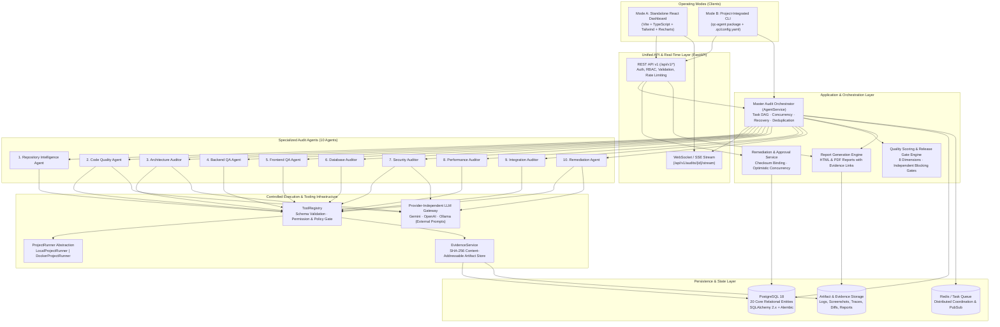
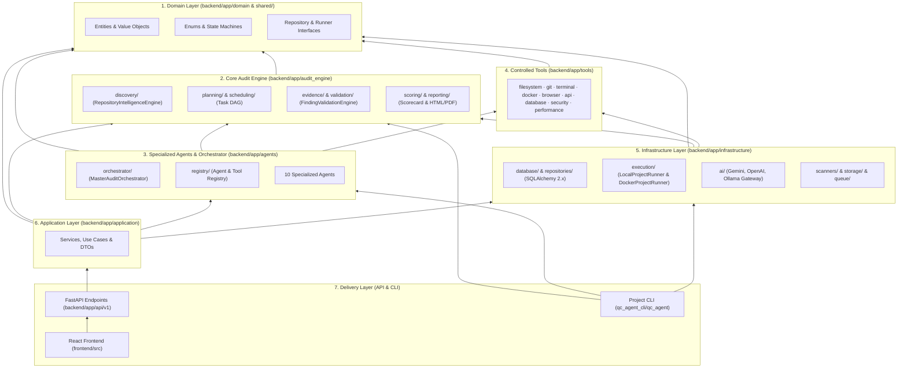
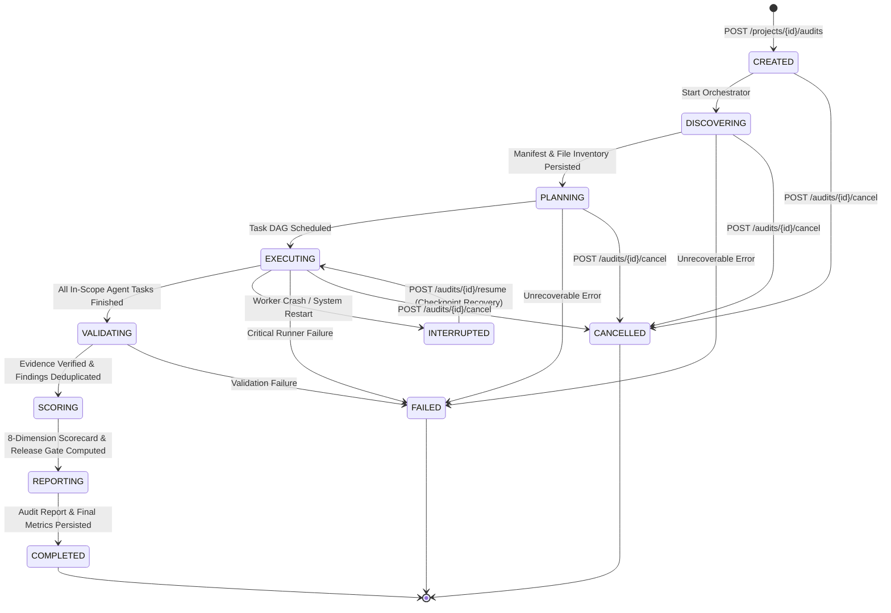
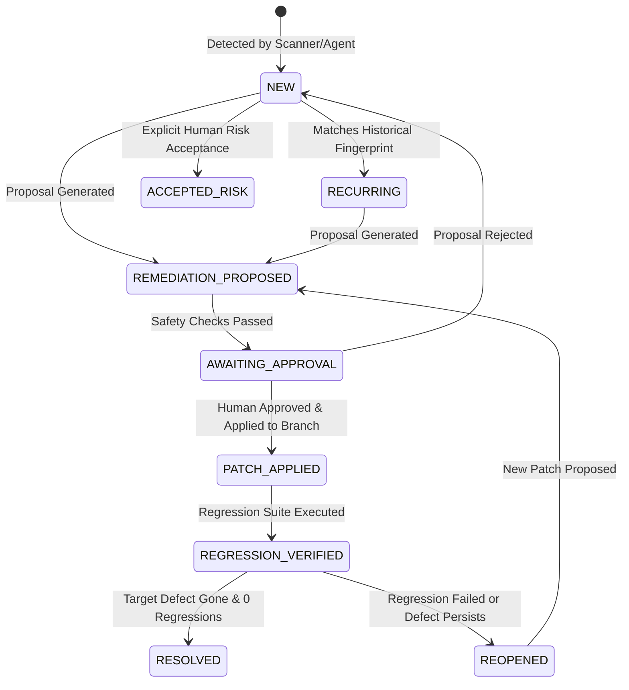
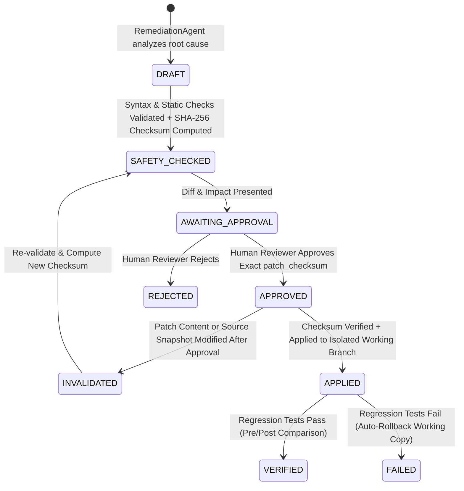

# Autonomous QC & Project Audit Intelligence Platform — Production System Architecture (v1.0)

## 1. Requirements & Engineering Principles Analysis

The **Autonomous QC & Project Audit Intelligence Platform** functions as an independent, automated software quality-control and technical audit department. It operates in two unified modes sharing a single core audit engine, finding schema, execution abstraction, evidence store, and reporting pipeline:

- **Mode A — Standalone QC Platform**: Centralized FastAPI backend + React/TypeScript/Vite dashboard where users register, upload, import, or select software repositories and execute, monitor, review, approve, and report on technical audits.
- **Mode B — Project-Integrated QC Agent (`qc-agent`)**: Distributable Python CLI package installed inside any repository, configured via `.qc/config.yaml`, capable of running autonomous local or Docker-isolated audits offline or synchronizing sessions, findings, and evidence with the central platform.

### Non-Negotiable Architectural Guarantees
1. **Evidence First**: No finding can transition to `CONFIRMED` without traceable `Evidence` records (SHA-256 checksummed artifacts, source locations, HTTP dumps, Playwright screenshots/traces, scanner JSON outputs, DB query proofs, or execution logs).
2. **Complete Inspection Coverage Tracking**: Every file discovered in a repository is persisted in `repository_files` with an explicit status (`PENDING`, `INSPECTED`, `EXCLUDED`, `UNSUPPORTED`, `FAILED`, `PARTIALLY_INSPECTED`) and an explicit exclusion/failure reason where applicable.
3. **Deterministic Execution vs. AI Reasoning**: Deterministic runners and tools (`LocalProjectRunner`, `DockerProjectRunner`, Pytest, HTTPX, Playwright, Ruff, Mypy, AST, Bandit, Semgrep, OSV, k6/concurrency probes) determine pass/fail outcomes. The LLM Gateway (`Gemini`, `OpenAI`, `Ollama`) plans tasks, analyzes context, investigates root causes, and proposes patches using externalized prompt templates.
4. **Human-Controlled Remediation**: Proposed code modifications are bound to an immutable SHA-256 `patch_checksum`. Original project files are never mutated without explicit human approval matching that checksum, and approved patches are applied in an isolated Git branch or sandbox workspace followed by automated regression verification.
5. **Reproducibility**: Every audit records the project Git commit/snapshot hash, file SHA-256 hashes, environment details, tool versions, executed commands, exit codes, configuration snapshot, AI provider/model, and UTC timestamps.

---

## 2. Detailed System Architecture



---

## 3. Database Entity-Relationship (ER) Diagram

All 20 required entities are implemented in PostgreSQL using SQLAlchemy 2.x with UUID primary keys, timezone-aware UTC timestamps, foreign-key constraints, composite indexes, and Alembic migrations.

```mermaid
erDiagram
    USERS ||--o{ PROJECTS : "owns"
    USERS ||--o{ PROJECT_MEMBERS : "joins"
    USERS ||--o{ APPROVALS : "reviews"
    PROJECTS ||--o{ PROJECT_MEMBERS : "has_members"
    PROJECTS ||--|| PROJECT_CONFIGURATIONS : "configured_by"
    PROJECTS ||--o{ AUDIT_SESSIONS : "has_audits"
    PROJECTS ||--o{ FINDINGS : "tracks"

    AUDIT_SESSIONS ||--o{ AUDIT_TASKS : "schedules"
    AUDIT_SESSIONS ||--o{ REPOSITORY_FILES : "inventories"
    AUDIT_SESSIONS ||--o{ FINDINGS : "discovers"
    AUDIT_SESSIONS ||--o{ EVIDENCE : "collects"
    AUDIT_SESSIONS ||--o{ TEST_RUNS : "executes"
    AUDIT_SESSIONS ||--o{ AUDIT_METRICS : "measures"
    AUDIT_SESSIONS ||--o{ EXECUTION_LOGS : "records"
    AUDIT_SESSIONS ||--o{ AGENT_EXECUTIONS : "tracks_agents"
    AUDIT_SESSIONS ||--o{ TOOL_EXECUTIONS : "tracks_tools"
    AUDIT_SESSIONS ||--o{ REPORTS : "generates"
    AUDIT_SESSIONS ||--o{ AUDIT_EVENTS : "emits"

    AUDIT_TASKS ||--o{ AGENT_EXECUTIONS : "runs"
    AUDIT_TASKS ||--o{ TOOL_EXECUTIONS : "invokes"
    AUDIT_TASKS ||--o{ EXECUTION_LOGS : "logs"
    AUDIT_TASKS ||--o{ EVIDENCE : "produces"

    FINDINGS ||--o{ EVIDENCE : "supported_by"
    FINDINGS ||--o{ REMEDIATION_PROPOSALS : "remediated_by"

    REMEDIATION_PROPOSALS ||--o{ APPROVALS : "requires"
    REMEDIATION_PROPOSALS ||--o{ PATCHES : "generates"

    PATCHES ||--o{ REGRESSION_RUNS : "verified_by"
    TEST_RUNS ||--o{ REGRESSION_RUNS : "linked_to"

    USERS {
        uuid id PK
        string email UK
        string password_hash
        string full_name
        string role "ADMIN | AUDITOR | DEVELOPER | VIEWER"
        boolean is_active
        timestamp created_at
        timestamp updated_at
    }

    PROJECTS {
        uuid id PK
        string name
        string slug UK
        string description
        string root_path
        string repository_url
        string default_branch
        uuid owner_id FK
        jsonb detected_stack
        boolean is_deleted
        timestamp deleted_at
        timestamp created_at
        timestamp updated_at
    }

    PROJECT_MEMBERS {
        uuid id PK
        uuid project_id FK
        uuid user_id FK
        string role "OWNER | MAINTAINER | AUDITOR | VIEWER"
        jsonb permissions
        timestamp created_at
    }

    PROJECT_CONFIGURATIONS {
        uuid id PK
        uuid project_id FK
        string execution_mode "LOCAL | DOCKER"
        jsonb exclusions
        jsonb custom_rules
        jsonb service_startup_config
        jsonb quality_gate_policy
        jsonb llm_config
        int retention_days
        timestamp updated_at
    }

    AUDIT_SESSIONS {
        uuid id PK
        uuid project_id FK
        uuid triggered_by FK
        string status "CREATED | DISCOVERING | PLANNING | EXECUTING | VALIDATING | SCORING | REPORTING | COMPLETED | FAILED | CANCELLED | INTERRUPTED"
        string audit_scope "FULL | CODE | BACKEND | FRONTEND | DATABASE | SECURITY | PERFORMANCE | E2E"
        string runner_mode "LOCAL | DOCKER"
        string commit_hash
        string branch_name
        jsonb manifest_summary
        jsonb scorecard
        string release_gate "APPROVED | APPROVED_WITH_WARNINGS | REJECTED | INCOMPLETE_AUDIT"
        jsonb environment_snapshot
        int total_tasks
        int completed_tasks
        int failed_tasks
        timestamp started_at
        timestamp completed_at
        timestamp created_at
    }

    AUDIT_TASKS {
        uuid id PK
        uuid session_id FK
        string task_key
        string agent_type
        string phase
        string status "PENDING | READY | RUNNING | COMPLETED | FAILED | SKIPPED | CANCELLED"
        jsonb dependencies
        jsonb input_payload
        jsonb result_summary
        int attempts
        int max_attempts
        float duration_seconds
        string error_message
        timestamp started_at
        timestamp completed_at
    }

    REPOSITORY_FILES {
        uuid id PK
        uuid session_id FK
        uuid project_id FK
        string relative_path
        string file_type
        string language
        bigint size_bytes
        int line_count
        string sha256_hash
        string inspection_status "PENDING | INSPECTED | EXCLUDED | UNSUPPORTED | FAILED | PARTIALLY_INSPECTED"
        string status_reason
        boolean is_entrypoint
        boolean is_test_file
        string component_boundary "BACKEND | FRONTEND | DATABASE | INFRASTRUCTURE | SHARED | TESTS | DOCS"
        jsonb imports_dependencies
        timestamp inspected_at
    }

    FINDINGS {
        uuid id PK
        uuid project_id FK
        uuid session_id FK
        string fingerprint
        string category
        string severity "CRITICAL | HIGH | MEDIUM | LOW | INFORMATIONAL"
        string title
        text description
        string file_path
        int line_start
        int line_end
        string agent_name
        jsonb reproduction_steps
        text expected_behavior
        text actual_behavior
        text root_cause
        text impact
        text recommended_fix
        float confidence
        string verification_status "UNVERIFIED | SUSPECTED | REPRODUCED | CONFIRMED | REJECTED | UNABLE_TO_VERIFY"
        string lifecycle_status "NEW | RECURRING | REMEDIATION_PROPOSED | AWAITING_APPROVAL | PATCH_APPLIED | REGRESSION_VERIFIED | RESOLVED | REOPENED | ACCEPTED_RISK"
        int occurrence_count
        uuid first_seen_session_id
        timestamp created_at
        timestamp updated_at
    }

    EVIDENCE {
        uuid id PK
        uuid session_id FK
        uuid task_id FK
        uuid finding_id FK
        string evidence_type "SOURCE_REFERENCE | COMMAND_OUTPUT | TEST_OUTPUT | BROWSER_SCREENSHOT | BROWSER_TRACE | API_RESPONSE | RUNTIME_LOG | DATABASE_VERIFICATION | SCANNER_REPORT | PERFORMANCE_RESULT | PATCH_DIFF"
        string storage_uri
        string sha256_checksum
        string source_tool
        text content_excerpt
        jsonb metadata_json
        timestamp created_at
    }

    TEST_RUNS {
        uuid id PK
        uuid session_id FK
        uuid task_id FK
        string test_suite_type "UNIT | INTEGRATION | API | BROWSER_E2E | DATABASE | SECURITY | PERFORMANCE | REGRESSION"
        string tool_name
        string command
        string status "PASSED | FAILED | ERROR | TIMED_OUT | SKIPPED"
        int total_tests
        int passed_tests
        int failed_tests
        int skipped_tests
        float duration_seconds
        int exit_code
        string output_evidence_uri
        jsonb details
        timestamp executed_at
    }

    AUDIT_METRICS {
        uuid id PK
        uuid session_id FK
        string dimension "CODE_QUALITY | BACKEND_RELIABILITY | FRONTEND_QUALITY | ARCHITECTURE | SECURITY | INTEGRATION | PERFORMANCE | TEST_QUALITY"
        string metric_name
        float metric_value
        string unit
        float weight
        jsonb breakdown
        timestamp recorded_at
    }

    EXECUTION_LOGS {
        uuid id PK
        uuid session_id FK
        uuid task_id FK
        string runner_type "LOCAL | DOCKER"
        string command
        string working_dir
        int exit_code
        float duration_seconds
        boolean timed_out
        string stdout_uri
        string stderr_uri
        string stdout_preview
        string stderr_preview
        timestamp executed_at
    }

    REMEDIATION_PROPOSALS {
        uuid id PK
        uuid finding_id FK
        uuid session_id FK
        string status "DRAFT | SAFETY_CHECKED | AWAITING_APPROVAL | APPROVED | REJECTED | APPLIED | VERIFIED | FAILED | INVALIDATED"
        text root_cause_analysis
        text explanation
        jsonb affected_files
        text expected_behavior
        text potential_impact
        jsonb safety_check_results
        jsonb test_plan
        text rollback_procedure
        string active_patch_checksum
        int version_id
        timestamp created_at
        timestamp updated_at
    }

    APPROVALS {
        uuid id PK
        uuid proposal_id FK
        uuid reviewer_id FK
        string decision "APPROVED | REJECTED"
        string approved_patch_checksum
        text comments
        boolean is_valid
        timestamp decided_at
    }

    PATCHES {
        uuid id PK
        uuid proposal_id FK
        string sha256_checksum
        string target_file_path
        text original_code
        text proposed_code
        text unified_diff
        string diff_artifact_uri
        string working_branch
        string base_commit_hash
        boolean syntax_valid
        boolean static_checks_passed
        timestamp applied_at
        timestamp created_at
    }

    REGRESSION_RUNS {
        uuid id PK
        uuid patch_id FK
        uuid test_run_id FK
        string status "PASSED | FAILED | ERROR"
        boolean issue_resolved
        boolean regressions_detected
        jsonb pre_fix_comparison
        jsonb post_fix_comparison
        timestamp verified_at
    }

    AGENT_EXECUTIONS {
        uuid id PK
        uuid session_id FK
        uuid task_id FK
        string agent_name
        string status "RUNNING | COMPLETED | FAILED"
        string llm_provider
        string llm_model
        int prompt_tokens
        int completion_tokens
        float estimated_cost_usd
        float duration_seconds
        jsonb warnings
        jsonb errors
        timestamp started_at
        timestamp completed_at
    }

    REPORTS {
        uuid id PK
        uuid session_id FK
        string report_format "HTML | PDF | JSON"
        string storage_uri
        string sha256_checksum
        string release_recommendation
        float overall_score
        boolean audit_complete
        jsonb incomplete_checks
        timestamp generated_at
    }

    TOOL_EXECUTIONS {
        uuid id PK
        uuid session_id FK
        uuid task_id FK
        string tool_name
        boolean is_mutating
        jsonb input_payload
        jsonb output_summary
        string status "ALLOWED | DENIED | COMPLETED | FAILED | TIMED_OUT"
        float duration_seconds
        timestamp executed_at
    }

    AUDIT_EVENTS {
        uuid id PK
        uuid session_id FK
        uuid project_id FK
        string event_type
        string actor
        string severity
        string message
        jsonb payload
        timestamp created_at
    }
```



---

## 4. Module Dependency Diagram (Clean Architecture)

Strict inward-pointing dependency rules prevent circular dependencies and isolate domain logic from infrastructure and transport concerns:



---

## 5. Agent Interfaces & Tool Contracts

### 5.1 Specialized Agent Contract
Every specialized agent inherits from `BaseSpecializedAgent` and implements:

```python
class AuditContext(BaseModel):
    session_id: UUID
    project_id: UUID
    project_name: str
    root_path: str
    workspace_path: str
    runner_mode: RunnerMode
    audit_scope: AuditScope
    manifest: dict[str, Any]
    configuration: dict[str, Any]

class AgentResult(BaseModel):
    agent_name: str
    task_id: UUID
    status: TaskStatus
    findings: list[FindingCreateDTO] = Field(default_factory=list)
    evidence_ids: list[UUID] = Field(default_factory=list)
    metrics: list[MetricCreateDTO] = Field(default_factory=list)
    test_runs: list[TestRunCreateDTO] = Field(default_factory=list)
    warnings: list[str] = Field(default_factory=list)
    errors: list[str] = Field(default_factory=list)
    duration_seconds: float
    prompt_tokens: int = 0
    completion_tokens: int = 0
    summary: dict[str, Any] = Field(default_factory=dict)

class BaseSpecializedAgent(ABC):
    agent_name: str
    supported_phases: list[str]

    @abstractmethod
    async def execute(self, context: AuditContext, task: AuditTaskDTO) -> AgentResult:
        ...
```

### 5.2 ToolRegistry Contract
Agents and LLM tool-calls cannot invoke raw OS shells. Every tool must be registered in `ToolRegistry`:

```python
class ToolDefinition(BaseModel):
    name: str
    description: str
    input_schema: type[BaseModel]
    output_schema: type[BaseModel]
    required_permissions: list[str]
    execution_policy: str  # "READ_ONLY_SANDBOX" | "CONTROLLED_EXECUTION" | "MUTATION_REQUIRES_APPROVAL"
    timeout_seconds: int = 60
    is_mutating: bool = False
```

Before execution, `ToolRegistry.invoke()` validates:
1. Input payload against `input_schema`.
2. Agent permissions against `required_permissions`.
3. Command/path against allowlist and workspace boundary.
4. Mutating tools (`is_mutating=True`) require an active, checksum-verified `Approval` record.
5. Output is validated against `output_schema` and logged in `tool_executions`.

---

## 6. Execution Isolation Model (`ProjectRunner`)

Both `LocalProjectRunner` and `DockerProjectRunner` implement the unified `ProjectRunner` interface:

```python
class ProjectRunner(ABC):
    @abstractmethod
    async def prepare_workspace(self, project_path: str, session_id: UUID, config: dict) -> WorkspaceInfo: ...
    @abstractmethod
    async def verify_snapshot(self, workspace: WorkspaceInfo) -> SnapshotVerification: ...
    @abstractmethod
    async def prepare_dependencies(self, workspace: WorkspaceInfo, manifest: dict) -> ExecutionResult: ...
    @abstractmethod
    async def execute_command(self, workspace: WorkspaceInfo, command: list[str], timeout: int = 60, env_overrides: dict | None = None) -> ExecutionResult: ...
    @abstractmethod
    async def start_service(self, workspace: WorkspaceInfo, service_config: ServiceStartupConfig) -> RunningServiceHandle: ...
    @abstractmethod
    async def check_service_health(self, handle: RunningServiceHandle) -> ServiceHealthStatus: ...
    @abstractmethod
    async def stop_service(self, handle: RunningServiceHandle) -> None: ...
    @abstractmethod
    async def collect_logs(self, handle: RunningServiceHandle) -> ServiceLogBundle: ...
    @abstractmethod
    async def cleanup(self, workspace: WorkspaceInfo) -> None: ...
```

### Security & Isolation Controls
| Control Layer | `LocalProjectRunner` | `DockerProjectRunner` |
| :--- | :--- | :--- |
| **Workspace** | Copies in-scope project files into an isolated disposable workspace `<storage>/workspaces/<session_id>/` so the original source tree is untouched during runtime tests. | Mounts isolated snapshot read-only (`:ro`) with explicit tmpfs/writable `/tmp` and `/workspace/build`. |
| **Process / User** | Runs subprocesses in isolated process groups with restricted `PATH` and stripped host credentials. | Runs as non-root `uid=10001(qcaudit)`, `--cap-drop=ALL`, `--security-opt=no-new-privileges`. |
| **Resource Limits** | Enforces wall-clock timeout and terminates entire child process tree on timeout. | Enforces `--cpus`, `--memory`, `--pids-limit`, and storage quota. Never mounts `/var/run/docker.sock`. |
| **Environment (`.env`)** | Never copies production `.env` secrets; generates synthetic test `.env.qc` with disposable test DB URL (`qc_sandbox_<short_id>`) and synthetic JWT/API secrets. | Injects synthetic environment variables only; network defaults to `--network=none` or isolated bridge for local service testing. |
| **Command Policy** | Enforces strict command allowlist (`pytest`, `ruff`, `mypy`, `uvicorn`, `npm`, `npx`, `node`, `playwright`, `bandit`, `semgrep`, `git`, `alembic`). | Enforces identical allowlist + container boundary. |

---

## 7. REST API & Real-Time Contracts (`/api/v1`)

| Domain | Method & Path | Description |
| :--- | :--- | :--- |
| **Auth** | `POST /api/v1/auth/login` | Authenticate user and issue JWT access token |
| | `POST /api/v1/auth/register` | Register user account |
| | `GET /api/v1/auth/me` | Current user profile & role permissions |
| **Projects** | `POST /api/v1/projects` | Register a software project (local path or Git repository URL) |
| | `GET /api/v1/projects` | List projects with summary metrics and pagination |
| | `GET /api/v1/projects/{project_id}` | Detailed project view, architecture stack, coverage, quality score, history |
| | `PUT /api/v1/projects/{project_id}/config` | Update project configuration, exclusions, quality gate policies |
| | `DELETE /api/v1/projects/{project_id}` | Soft-delete a project |
| **Discovery** | `POST /api/v1/projects/{project_id}/discover` | Trigger Repository Intelligence Engine scan |
| | `GET /api/v1/projects/{project_id}/manifest` | Get machine-readable project manifest & inspection coverage |
| | `GET /api/v1/projects/{project_id}/files` | Paginated repository files with filter by status/language/boundary |
| **Audits** | `POST /api/v1/projects/{project_id}/audits` | Create and start an `AuditSession` (`FULL`, `CODE`, `BACKEND`, `FRONTEND`, `SECURITY`, `E2E`, etc.) |
| | `GET /api/v1/audits` | List audit sessions across projects with filters |
| | `GET /api/v1/audits/{audit_id}` | Get full audit session details, scorecard, tasks, metrics, test runs, logs |
| | `POST /api/v1/audits/{audit_id}/cancel` | Cancel an active audit session cleanly |
| | `POST /api/v1/audits/{audit_id}/resume` | Resume an interrupted/failed audit session from last checkpoint |
| | `GET /api/v1/audits/{audit_id}/progress` | Real-time deterministic progress snapshot (completed/total tasks, active agents) |
| | `GET /api/v1/audits/{audit_id}/stream` | Server-Sent Events (SSE) / WebSocket stream for live logs & state transitions |
| **Findings** | `GET /api/v1/audits/{audit_id}/findings` | Paginated findings for an audit session |
| | `GET /api/v1/findings` | Global findings explorer (filter by severity, category, agent, file, status, verification) |
| | `GET /api/v1/findings/{finding_id}` | Full finding details with linked evidence and remediation proposals |
| | `PATCH /api/v1/findings/{finding_id}` | Update verification status or lifecycle status (with audit event trail) |
| **Evidence** | `GET /api/v1/findings/{finding_id}/evidence` | List all evidence records backing a finding |
| | `GET /api/v1/evidence` | Browse evidence across sessions/types |
| | `GET /api/v1/evidence/{evidence_id}/artifact` | Download/view raw evidence artifact (log, screenshot, JSON report, diff) |
| **Remediation** | `POST /api/v1/findings/{finding_id}/proposals` | Generate root-cause analysis and proposed patch via `RemediationAgent` |
| | `GET /api/v1/remediation` | List remediation proposals across projects/sessions |
| | `GET /api/v1/remediation/{proposal_id}` | Get proposal details, original/proposed code, unified Git diff, checksum, impact |
| | `POST /api/v1/remediation/{proposal_id}/approve` | Human approval bound to `patch_checksum` |
| | `POST /api/v1/remediation/{proposal_id}/reject` | Human rejection with reviewer comments |
| | `POST /api/v1/remediation/{proposal_id}/apply` | Apply approved patch in isolated working branch, run regression tests, verify fix |
| **Reports** | `POST /api/v1/audits/{audit_id}/reports` | Generate comprehensive HTML or PDF technical audit report |
| | `GET /api/v1/audits/{audit_id}/reports` | List generated reports for an audit session |
| | `GET /api/v1/reports/{report_id}/download` | Download/view generated HTML or PDF report |
| **System** | `GET /api/v1/system/overview` | Executive dashboard telemetry (projects, audits, findings, pending approvals) |
| | `GET /api/v1/system/health` | Deep health check (PostgreSQL, storage, runners, LLM providers) |
| | `GET /api/v1/system/agents` | Registered specialized agents, capabilities, and execution statistics |
| | `GET /api/v1/system/executors` | Local & Docker executor status, policies, and available scanner binaries |

---

## 8. Audit Session State Machine



---

## 9. Finding Lifecycle & Remediation Approval State Machines

### 9.1 Finding Verification & Lifecycle State Machine


### 9.2 Remediation Proposal & Checksum-Bound Approval State Machine


---

## 10. Phase 0 Implementation Checklist

- [x] **Architecture & Blueprint Documentation**: `docs/architecture/SYSTEM_ARCHITECTURE.md`, `docs/development/DECISION_LOG.md`, `docs/development/PROGRESS.md`.
- [ ] **Modular Monorepo Directory Structure**: Create all directories mandated in Section 5 (`backend/`, `frontend/`, `qc_agent_cli/`, `execution/`, `shared/`, `infrastructure/`, `docs/`, `scripts/`).
- [ ] **PostgreSQL 18 Database Cluster & Alembic**: Provision local PostgreSQL 18 database (`qc_platform`), implement all 20 SQLAlchemy 2.x models with indexes and relationships, configure Alembic, and apply initial schema migration.
- [ ] **Backend Core & Security Foundation**: Implement Pydantic V2 configuration (`config.py`), JWT + password hashing + RBAC (`security.py`), structured JSON logger (`logging.py`), custom domain exceptions (`exceptions.py`), and Audit/Remediation state machines.
- [ ] **Phase 0 API Vertical Slice**: Implement `/api/v1/auth/*`, `/api/v1/projects/*`, `/api/v1/audits/*`, `/api/v1/system/*` backed by real PostgreSQL persistence.
- [ ] **React + TypeScript + Vite + Tailwind CSS Dashboard Shell**: Implement full navigation layout for all 17 dashboard views and functional Overview, Projects, Project Details, Audit Sessions, and System Settings pages connected to the live FastAPI backend.
- [ ] **Phase 0 Verification**: Run backend, frontend, Alembic migrations, and Pytest unit + integration tests verifying database persistence and state transitions.

